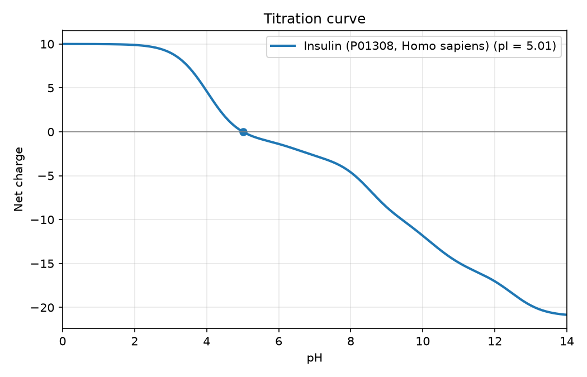

# Protein report: Insulin (P01308, Homo sapiens)

Generated by Protein Analyzer on 2026-11-18.

## Titration curve



## Insulin (P01308, Homo sapiens)

Source: https://www.uniprot.org/uniprotkb/P01308

| Property | Value |
|---|---|
| Length | 110 residues |
| Molecular weight | 11,980.91 Da |
| Isoelectric point (pI) | 5.01 |
| Net charge at pH 7.0 | -2.72 |
| Extinction coefficient (280 nm) | 17,335 M⁻¹ cm⁻¹ (all Cys as cystines); 16,960 (all Cys reduced) |
| GRAVY | 0.193 (overall hydrophobic) |

### Amino acid composition

| Amino acid | Count | Percent |
|---|---:|---:|
| Alanine (A) | 10 | 9.1% |
| Cysteine (C) | 6 | 5.5% |
| Aspartate (D) | 2 | 1.8% |
| Glutamate (E) | 8 | 7.3% |
| Phenylalanine (F) | 3 | 2.7% |
| Glycine (G) | 12 | 10.9% |
| Histidine (H) | 2 | 1.8% |
| Isoleucine (I) | 2 | 1.8% |
| Lysine (K) | 2 | 1.8% |
| Leucine (L) | 20 | 18.2% |
| Methionine (M) | 2 | 1.8% |
| Asparagine (N) | 3 | 2.7% |
| Proline (P) | 6 | 5.5% |
| Glutamine (Q) | 7 | 6.4% |
| Arginine (R) | 5 | 4.5% |
| Serine (S) | 5 | 4.5% |
| Threonine (T) | 3 | 2.7% |
| Valine (V) | 6 | 5.5% |
| Tryptophan (W) | 2 | 1.8% |
| Tyrosine (Y) | 4 | 3.6% |

### Sequence

```
   1 MALWMRLLPL LALLALWGPD PAAAFVNQHL CGSHLVEALY LVCGERGFFY TPKTRREAED
  61 LQVGQVELGG GPGAGSLQPL ALEGSLQKRG IVEQCCTSIC SLYQLENYCN
```

## Methods

- **Molecular weight:** sum of average residue masses plus one water.
- **Net charge and pI:** Henderson–Hasselbalch equation using EMBOSS pKa values (N-terminus 8.6, C-terminus 3.6, side chains: K 10.8, R 12.5, H 6.5, D 3.9, E 4.1, C 8.5, Y 10.1). The pI is found by bisection. Other tools use different pKa values, so their pI may differ.
- **Extinction coefficient:** Pace et al. (1995); Trp 5500, Tyr 1490, cystine 125 M⁻¹ cm⁻¹.
- **GRAVY:** average Kyte–Doolittle hydropathy.
